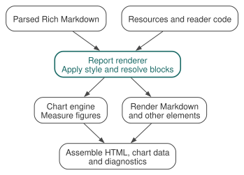

# Report renderer

## Overview

The Report renderer ([`richview-core`](../../crates/richview-core/Cargo.toml)) is the Rust library that turns Rich Markdown (`.rmd`) and resolved resources into HTML, chart data and diagnostics. A diagnostic is a finding that tells the author what happened and where to look in the source. The [Command-line program](cli.md), [Cowork report server](server.md) (`richview-app`), [editor preview](../../crates/richview-editor/src/lsp.rs#L839) and browser [Playground](../../crates/richview-site/src/browser.rs#L298) each call the library with the inputs available to them. The renderer never reads files, fetches URLs, starts processes, reads the environment or consults the clock. The caller supplies those inputs and decides where the resulting page goes. [Document interface](../../crates/richview-core/src/document.rs) · [Architecture boundary](../lockdown/BOUNDARIES.md)

## Module structure

- [`richview-core`](../../crates/richview-core/src/lib.rs) exposes the document interface, the report vocabulary and helpers for authors and hosts.
  - [`document.rs`](../../crates/richview-core/src/document.rs) defines a parsed report, the options a caller supplies and the results it receives.
  - [`parser.rs`](../../crates/richview-core/src/parser.rs) reads the report header and separates rich blocks from ordinary Markdown.
  - [`fences.rs`](../../crates/richview-core/src/fences.rs) identifies fenced source regions so the parser can preserve their boundaries.
  - [`yaml.rs`](../../crates/richview-core/src/yaml.rs) reads the structured text in headers, blocks and style files and records source positions.
  - [`registry.rs`](../../crates/richview-core/src/registry.rs) defines the supported fields, types and diagnostic codes.
  - [`walker.rs`](../../crates/richview-core/src/walker.rs) checks values against the rules for their place in the document.
  - [`folder.rs`](../../crates/richview-core/src/folder.rs) finds resource references and checks them against the caller’s inventory of the Report folder.
  - [`asset.rs`](../../crates/richview-core/src/asset.rs) validates a remote file reference, including its address, size and integrity information.
  - [`style.rs`](../../crates/richview-core/src/style.rs) combines style layers into one set of values for the report and its charts.
    - [`style/presets.rs`](../../crates/richview-core/src/style/presets.rs) supplies the recipes behind named styles.
    - [`style/vocabulary.rs`](../../crates/richview-core/src/style/vocabulary.rs) defines the accepted style settings and their value rules.
    - [`style/checks.rs`](../../crates/richview-core/src/style/checks.rs) reports problems with the resolved style and the fonts used for the report’s text.
  - [`company_brand.rs`](../../crates/richview-core/src/company_brand.rs) resolves the company name, logo and background picture from the supplied style and resources.
  - [`render.rs`](../../crates/richview-core/src/render.rs) assembles the page and collects findings from every stage.
  - [`markdown.rs`](../../crates/richview-core/src/markdown.rs) turns ordinary report Markdown into HTML, including headings, links and footnotes.
    - [`highlight.rs`](../../crates/richview-core/src/highlight.rs) marks tokens in code examples while preserving the source text.
  - [`blocks.rs`](../../crates/richview-core/src/blocks.rs) resolves dataset values and renders report elements such as tables and images.
  - [`figure.rs`](../../crates/richview-core/src/figure.rs) calls the [Chart engine](chart-engine.md) and packages each chart for screen or paper.
  - [`columns.rs`](../../crates/richview-core/src/columns.rs) assigns blocks to the columns the author describes.
  - [`slides.rs`](../../crates/richview-core/src/slides.rs) reads a `.rslide` deck into slides and slots, places each slot on the 24 by 24 stage and measures the space available to each figure.
  - [`reading.rs`](../../crates/richview-core/src/reading.rs) derives the table of contents and reading-progress markup from the document.
  - [`shell.rs`](../../crates/richview-core/src/shell.rs) writes page elements shared by reports, including the document head and content security policy.
  - [`knowledge.rs`](../../crates/richview-core/src/knowledge.rs) supplies the authoring guide returned by `richview learn`.
  - [`spec.rs`](../../crates/richview-core/src/spec.rs) derives the reference tables for the [Rich Markdown specification](../RMD-SPEC.md).

## Architecture



The parser preserves a place in the text for each rich block, so the host can resolve a file between parsing and rendering without losing the block’s source line. The renderer combines that document with the host’s inputs. For a chart, it passes rows, style and width to the Chart engine and uses the returned layout to size the figure. The caller gets one result in memory. For a local export the Command-line program writes the [HTML report file](cli.md#what-is-stored-where-and-what-is-rebuilt), and the [Report reader](runtime.md) draws its interactive charts when the file opens.

## Pipeline

Consider the [first report](../../examples/first-report/report.rmd), which names a [style file](../../examples/first-report/report.rstyle.yaml) and an [orders dataset](../../examples/first-report/data/orders.csv). The chart contains inline rows. The table reads the CSV through this reference.

```yaml
data:
  csv: data/orders.csv
```

The parser preserves that reference and its source position. The host provides the CSV contents under `data/orders.csv`. If the author changes only the CSV and renders again, the table can change while the chart keeps its authored values. [Example source](../../examples/first-report/report.rmd) · [Dataset resolution](../../crates/richview-core/src/blocks.rs#L9)

1. **Parse the source.** `document::parse` takes UTF-8 text. It reads the frontmatter, the optional header between delimiters at the top of the file, and scans the Markdown for rich blocks. It returns a `Document` containing the header, body with placeholders, decoded blocks, source positions and findings. [parser.rs:41](../../crates/richview-core/src/parser.rs#L41) · [document.rs:234](../../crates/richview-core/src/document.rs#L234)

   - A recoverable failure in a rich fence leaves a failed block at that position. The document retains enough information to show the author what needs repair. [document.rs:223](../../crates/richview-core/src/document.rs#L223)
   - For validation alone, `validate` returns the source findings here. `validate_publish` additionally checks the metadata needed for publication. [parser.rs:1604](../../crates/richview-core/src/parser.rs#L1604) · [parser.rs:1612](../../crates/richview-core/src/parser.rs#L1612)
   - If the source exceeds the parser’s size limit, the caller receives findings before a document is created. [parser.rs:42](../../crates/richview-core/src/parser.rs#L42)

1. **Supply the resources.** `report_resources` identifies resources from the parsed document. The host supplies a Report folder inventory and the values it resolved, keyed by reference in `RenderOptions.data`. `render_blockers` checks the inventory before layout. [folder.rs:29](../../crates/richview-core/src/folder.rs#L29) · [document.rs:261](../../crates/richview-core/src/document.rs#L261) · [folder.rs:341](../../crates/richview-core/src/folder.rs#L341)

   - A native host can read the orders CSV from disk. A browser host can supply a file from its virtual Report folder. The renderer receives its contents in either case. [Native resolver](../../crates/richview-app/src/resolver.rs#L151) · [Playground renderer](../../crates/richview-site/src/browser.rs#L298)
   - A missing file can produce a finding and leave the rest of the draft readable. An invalid Report folder can stop the whole render. [folder.rs:546](../../crates/richview-core/src/folder.rs#L546)

1. **Resolve the style.** `render_document_internal` reads the header’s ordered style references, appends the caller’s styles and adds the report’s own background last. `resolve_styles` validates and combines the layers. The result supplies page typography, colors and chart settings. [render.rs:217](../../crates/richview-core/src/render.rs#L217) · [style.rs:300](../../crates/richview-core/src/style.rs#L300)

1. **Render the blocks.** `blocks::resolve_data` looks up referenced data and supplies rows for the block. The renderer checks those fields and chooses an output for each block. [blocks.rs:9](../../crates/richview-core/src/blocks.rs#L9) · [render.rs:529](../../crates/richview-core/src/render.rs#L529)

   - **Ordinary report element.** A table, for example, becomes HTML containing its rows. The caller can inspect the page without running chart code. [blocks.rs:1137](../../crates/richview-core/src/blocks.rs#L1137)
   - **Screen chart.** `figure::chart` asks the Chart engine to lay out the chart. The renderer writes a figure with reserved space and embeds the chart definition and data that the Report reader needs at the actual screen width. [figure.rs:644](../../crates/richview-core/src/figure.rs#L644) · [figure.rs:895](../../crates/richview-core/src/figure.rs#L895)
   - **Print chart.** The same figure path uses the print layout and asks the Chart engine for SVG, a vector drawing the browser can print at page resolution. [figure.rs:744](../../crates/richview-core/src/figure.rs#L744)
   - **Block with a data error.** The renderer inserts a notice at the block’s position and retains the finding. Other blocks continue through the loop. [render.rs:557](../../crates/richview-core/src/render.rs#L557)

1. **Assemble the page.** `markdown_html` renders the body, then `expand_blocks` fills the generated placeholders. The renderer adds the header, reading aids, styles, font notices and trusted reader code, checks the final byte length and constructs the result. [render.rs:782](../../crates/richview-core/src/render.rs#L782) · [render.rs:874](../../crates/richview-core/src/render.rs#L874) · [render.rs:1173](../../crates/richview-core/src/render.rs#L1173)

   - **Fenced code.** When a fence names a language the renderer recognizes, such as SQL, it highlights the tokens and preserves the spacing and line breaks. Other fences display plain text. The resolved report style supplies the highlighting colors. [Code lines](../../crates/richview-core/src/markdown.rs#L869) · [Report CSS](../../crates/richview-core/src/render.rs#L1033)

1. **Return what the caller requested.** The [document interface](../../crates/richview-core/src/render.rs#L18) exposes different views of the result.

   - **Render.** `render_document` returns a `RenderedReport` with HTML, diagnostics, metadata and chart payloads. A recoverable finding can accompany a complete page. [render.rs:18](../../crates/richview-core/src/render.rs#L18) · [document.rs:356](../../crates/richview-core/src/document.rs#L356)
   - A diagnostic carries its level, code, message and field path. A file, line, column, tag or suggested fix accompanies it when known. Lines and columns start at 1. [document.rs:68](../../crates/richview-core/src/document.rs#L68)
   - **Check.** `check_document` adds author guidance, runs the same rendering path and returns status, diagnostics and chart measurements. This lets an author inspect a label collision at a specific width without saving a page. [render.rs:32](../../crates/richview-core/src/render.rs#L32) · [render.rs:158](../../crates/richview-core/src/render.rs#L158)

## What is stored where, and what is rebuilt

| Thing | Where it lives | Who writes it | What makes it stale or rebuilt |
| --- | --- | --- | --- |
| Rich Markdown, style files and datasets | The physical or virtual Report folder | The author or host | A source edit needs a new parse. A resource edit needs new resolved inputs for the next render. |
| Parsed report | `Document` in caller memory, optionally serialized for a worker | `parse` | The caller can reuse it while the source matches. Rendering consumes the parsed value it is given. |
| Resolved resources and inventory | `RenderOptions.data` and `report_folder` in caller memory | The host | The host supplies a fresh inventory and values when files change. |
| Built-in styles and native font catalog | Bundled crate assets | The native build | A build with different assets changes subsequent renders. |
| Browser font catalog | Renderer memory in a WebAssembly host | The host supplies the staged catalog through `provide_font_catalog` | A new WebAssembly instance needs a catalog to use the bundled faces. |
| Derived brand colors | Per-thread memory cache, up to 32 combinations | The brand color resolver | Reusing the same inputs reuses the colors. Adding another combination evicts the least recently used entry when full. |
| Style values and chart layouts | In memory during rendering | `resolve_styles` and the Chart engine | The renderer computes them for the supplied document, data, style and widths. |
| Screen chart payload | In `RenderedReport.charts` and in the figure’s embedded data | `figure::chart` | A new render uses the current chart definition and rows. The reader computes layout again at the displayed width. |
| HTML and report metadata | `RenderedReport.html` and `metadata` | `render_document` | A fresh render returns a new result. The caller decides whether to write, serve or discard it. |
| Diagnostics and chart checks | `RenderedReport` or `CheckReport` | Parser, renderer and check functions | Each call returns the findings for its own inputs. |

The [brand color cache](../../crates/richview-core/src/style/brand.rs#L392) saves repeated color calculations during editing. It holds no source documents or rendered pages.

The [document types](../../crates/richview-core/src/document.rs#L212) describe what can cross between a host and its rendering worker. [Font catalog support](../../crates/richview-core/src/style.rs#L668) and [chart packaging](../../crates/richview-core/src/figure.rs#L895) show which resources the host supplies once and which travel inside a particular report.

## Configuration and limits

**Caller settings.** `RenderOptions` is the configuration interface. It carries ordered style layers, folder inventory, dataset or media contents, chart widths, reader code, output mode and page size. `source` identifies the input in the returned metadata. Command flags and environment variables belong to the host. [Render options](../../crates/richview-core/src/document.rs#L261)

**Style order.** When no layer names a built-in preset, `cascade_refs` puts `sleek` underneath the author’s layers. Later layers can override individual settings. A report background in frontmatter takes precedence over backgrounds supplied by style files. [Style cascade](../../crates/richview-core/src/style.rs#L247) · [Report background](../../crates/richview-core/src/render.rs#L258)

**Reader code.** For offline export the host supplies bindings and base64-encoded WebAssembly, either raw or gzip-compressed. For a linked reader, `runtime_url` supplies the base address and matching `runtime_js` supplies the bytes used for the integrity check. If the linked form also supplies WebAssembly bytes, they must use the raw codec. [Reader embedding](../../crates/richview-core/src/render.rs#L1817)

**Paper.** `Output::Report` is the default. `Output::Pdf` produces print-ready HTML, which the host prints. The paper defaults to A4 and also accepts Letter. The page box allows 20 mm above the text, 18 mm on each side and 22 mm below. [Page settings](../../crates/richview-core/src/document.rs#L316)

**Source, 16 MiB.** The parser refuses a larger `.rmd` before allocating the parsed document. Moving a large inline dataset into a separate resource reduces the source size. [Source check](../../crates/richview-core/src/parser.rs#L41)

**One resolved dataset, 16 MiB.** An oversized dataset produces a data finding. For a chart or table whose data cannot be read, the renderer can show a notice where that block belongs. [Dataset contract](../../crates/richview-core/src/document.rs#L54) · [Block handling](../../crates/richview-core/src/render.rs#L534)

**Generated HTML, 64 MiB.** The renderer checks accumulated block output and the complete HTML string, including embedded media, fonts and reader code. Exceeding the budget stops the render. [Block budget](../../crates/richview-core/src/render.rs#L531) · [Final budget](../../crates/richview-core/src/render.rs#L1184)

**Chart widths, 240 through 4096 pixels.** The host’s `width` defaults to 720. That value and every entry in `chart_widths` must be finite and in range or the whole call fails. With no explicit check widths the renderer uses the report layout, including a 358-pixel phone column and a desktop measure derived from the style. [Defaults](../../crates/richview-core/src/document.rs#L295) · [Range check](../../crates/richview-core/src/render.rs#L184) · [Reference widths](../../crates/richview-core/src/render.rs#L1693)

**YAML, one document and 64 nested collection levels.** A second document or a deeper list or mapping is rejected with a source position. The same parser reads frontmatter, rich fences and style files. [YAML reader](../../crates/richview-core/src/yaml.rs#L77) · [YAML profile](../RMD-SPEC.md#yaml-profile)

**Report inventory, one source.** The host must identify one `.rmd` in a dedicated Report folder and supply its name and inventory. The folder check rejects a missing inventory or competing report sources. [Folder validation](../../crates/richview-core/src/folder.rs#L158)

**Publish identity.** A slug, the report’s address name, can contain up to 80 lowercase ASCII letters, digits and separating hyphens. A version can occupy up to 64 bytes. The publish check requires a title, description and valid version. [Identity rules](../../crates/richview-core/src/identity.rs) · [Publication metadata](../../crates/richview-core/src/parser.rs#L1612)

**Remote file references.** An asset URL can contain up to 2,048 characters. Its declared length must be from 1 through 9,007,199,254,740,991 bytes, the largest safe integer in JavaScript. An invalid reference produces a finding. [Reference fields](../../crates/richview-core/src/asset.rs#L184) · [Address check](../../crates/richview-core/src/asset.rs#L305)

**Company logo, 512 KiB and 1024 pixels per side.** An image exceeding either limit fails validation. [Logo checks](../../crates/richview-core/src/company_logo.rs#L6)

**Background picture, 400 KiB and 2400 pixels per side.** An invalid picture produces a style finding. The renderer uses the accepted background settings without the rejected image. [Picture limits](../../crates/richview-core/src/company_logo.rs#L10) · [Background resolution](../../crates/richview-core/src/company_brand.rs)

**Brand font, 3 MiB of base64 per face.** The font validator bounds the encoded payload and checks for a WOFF2 font signature. A style embedding faces at more than three distinct weights receives a warning. [Font input](../../crates/richview-core/src/style.rs#L1624) · [Style checks](../../crates/richview-core/src/style/checks.rs#L18)

**Code from a file, 400 lines.** A longer referenced text file produces an error for the block. The author can excerpt the relevant lines into the report. [Code renderer](../../crates/richview-core/src/blocks.rs#L843)

**Columns, 2 through 4.** The column grammar accepts a row in that range. The [column parser](../../crates/richview-core/src/columns.rs) checks the column declaration and how the body is divided.

**Slides.** A deck names itself in its first line, `format: rslide/1`, so every host that holds only the text reads it as a deck. A slide's slots share a 24 by 24 stage: a head in rows 1 to 4 and a foot in rows 23 and 24 when the slide has furniture for them. The slide checker reports a slot of text that holds more than 40 words (80 when it is at least half the stage wide), a title of more than 90 characters and a table of more than ten data rows. [Slide budgets](../../crates/richview-core/src/slides.rs#L50) · [Slide checks](../../crates/richview-core/src/slides.rs#L1574)

**Print figures.** The renderer tries to fit a chart within 60% of the printable page height. The renderer can narrow the figure toward a 240-pixel minimum. If the resulting figure is still too tall, the author receives a warning. [Print layout](../../crates/richview-core/src/figure.rs#L712) · [Print thresholds](../../crates/richview-core/src/figure.rs#L957)

**Reading navigation.** The renderer offers a table of contents for reports with at least three top-level sections and no tabs. `toc: false` disables it and `progress: false` disables the reading-progress bar. The renderer writes plain links for the contents. [Reading aids](../../crates/richview-core/src/reading.rs#L1)

**Heading depth.** The page title takes heading level 1. Body headings move down one level. An authored level-6 heading stays at level 6 and produces a warning because HTML has no deeper heading level. [Heading handling](../../crates/richview-core/src/markdown.rs#L618)

**Print footer, 70 characters.** The renderer shortens an overlong running title at a word boundary when possible and adds an ellipsis. The limit affects the page foot. [Running title](../../crates/richview-core/src/render.rs#L1778)

**Style checks.** A type scale step below 1.2 on desktop, or below 1.125 on a phone of 640 pixels or narrower, can produce a warning. The [style checks](../../crates/richview-core/src/style/checks.rs#L14) also define contrast minima for the text and surfaces that use them.

**Source format.** The accepted major version is `rmd/1`. A report can omit the format declaration. A newer major produces a finding on the header so the author can identify the incompatible source. [Format constant](../../crates/richview-core/src/document.rs#L49) · [Source contract](../RMD-SPEC.md#document-metadata)

**Location of style findings.** When a layer comes from a file, the renderer attaches its report-relative filename to the finding. When a background comes from the report header, the renderer maps the finding back to that header field. [Style locations](../../crates/richview-core/src/render.rs#L282)

**Unknown fields.** The validator warns about an unrecognized key. It drops an unknown block field and preserves an unknown header field in metadata. Neither controls how the report looks. [Field validation](../../crates/richview-core/src/walker.rs#L1)

**Field-specific limits.** The [Rich Markdown specification](../RMD-SPEC.md) gives the accepted values and diagnostic reference. The [Chart engine](chart-engine.md#configuration-and-limits) owns limits on chart geometry and data per chart type.
