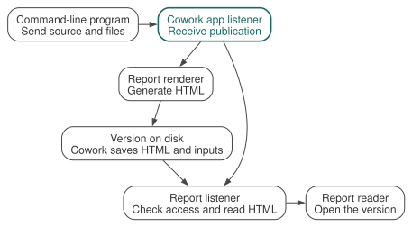

# Cowork report server

## Overview

The Cowork report server is the part of [`richview-app`](../../crates/richview-app/Cargo.toml) that gives a report a web address and decides who can open it. A publisher sends Rich Markdown source, its data and its files to the app address. Cowork runs the [Report renderer](core.md) (`richview-core`), stores a version and returns a link to that version and a link that follows the report. A browser opening either link reads the stored page through a separate report listener. Cowork never accepts a publisher's HTML as the page to serve. [Server entry point](../../crates/richview-app/src/cli.rs#L293) · [Publish handler](../../crates/richview-app/src/server/reports.rs#L354)

## Module structure

- [`richview-app`](../../crates/richview-app/Cargo.toml) builds the `richview` executable used by both publishers and the server.
  - [`src/cli.rs`](../../crates/richview-app/src/cli.rs#L311) reads server settings, opens the data directory and starts the listeners.
  - [`src/server/mod.rs`](../../crates/richview-app/src/server/mod.rs) assembles the application and report listeners and checks incoming requests.
    - [`routes.rs`](../../crates/richview-app/src/server/routes.rs) assigns method and path to a handler for each listener and server mode.
    - [`reports.rs`](../../crates/richview-app/src/server/reports.rs) publishes, lists, reads, downloads and manages report versions.
    - [`auth.rs`](../../crates/richview-app/src/server/auth.rs) identifies callers and enforces the right needed for a request.
    - [`origin.rs`](../../crates/richview-app/src/server/origin.rs) hands a reader from the app address to the report address.
    - [`governance.rs`](../../crates/richview-app/src/server/governance.rs) handles changes to people, tokens and report access.
    - [`ui.rs`](../../crates/richview-app/src/server/ui.rs) builds and serves the self-hosted management pages.
    - [`hosted_routes.rs`](../../crates/richview-app/src/server/hosted_routes.rs) maps hosted organization and report addresses to handlers.
    - [`operator.rs`](../../crates/richview-app/src/server/operator.rs) serves hosted administration on a separate machine-local listener.
  - [`src/storage.rs`](../../crates/richview-app/src/storage.rs) writes versions, selects the latest version and retains the Report reader each version needs.
  - [`src/access.rs`](../../crates/richview-app/src/access.rs) stores accounts, roles and report permissions and coordinates changes to them with publication.
    - [`access/teams.rs`](../../crates/richview-app/src/access/teams.rs) manages organization membership and invitations.
    - [`access/cli_sign_in.rs`](../../crates/richview-app/src/access/cli_sign_in.rs) lets a publisher confirm a Command-line program sign-in in a browser.
  - [`src/hosted_links.rs`](../../crates/richview-app/src/hosted_links.rs) issues one-use email links for signup, password reset and invitation.
  - [`src/mail.rs`](../../crates/richview-app/src/mail.rs) delivers hosted mail through an outbox or mail relay.

## Architecture

The write crosses the app listener once. Cowork derives the HTML itself and commits it with the inputs that produced it. On a read, the app can pass a signed-in reader to the report listener with a short-lived ticket for one report. The report listener checks viewing rights and serves the stored bytes and the matching Report reader. [Origin handoff](../../crates/richview-app/src/server/origin.rs#L68) · [Read handler](../../crates/richview-app/src/server/reports.rs#L1437)

## Pipeline

Follow one publication from the publisher's terminal to a colleague's browser.

1. **Receive the publication.** The Command-line program sends JSON to `POST /api/reports`. The request names the report by a short address called its *slug*. It carries source, ordered styles, resolved data and linked files. The app checks the caller’s identity before buffering the body. Once it has the slug, it checks what the caller may do on that report. [cli.rs:1374](../../crates/richview-app/src/cli.rs#L1374) · [server/mod.rs:319](../../crates/richview-app/src/server/mod.rs#L319)

1. **Choose the report.** `publish_api` validates the slug and the version in the source header. In hosted mode the key includes the organization, so two organizations can use the same slug. [reports.rs:354](../../crates/richview-app/src/server/reports.rs#L354)

   - **First publication.** The caller needs permission to create a report and must confirm the new address with `new: true` (`--new` in the Command-line program).
   - **Existing address.** The caller needs edit permission. Changing its visibility also requires sharing permission. [reports.rs:494](../../crates/richview-app/src/server/reports.rs#L494)

1. **Render the source.** Cowork checks for each linked local download, excluding links to other Rich Markdown sources. It runs the [Report renderer](core.md) with the supplied inputs, links the server's copy of the Report reader and rewrites download links to the version's own files. A render error stops publication. [reports.rs:554](../../crates/richview-app/src/server/reports.rs#L554) · [reports.rs:595](../../crates/richview-app/src/server/reports.rs#L595)

1. **Commit the version.** `commit_publication` checks the caller's rights again. The store calculates a content fingerprint from the source, ordered styles, data and linked files. [reports.rs:633](../../crates/richview-app/src/server/reports.rs#L633) · [storage.rs:374](../../crates/richview-app/src/storage.rs#L374)

   - **New version.** The store checks available capacity, writes the files in a staging directory and renames it into place.
   - **Same version, same fingerprint.** Cowork returns the stored version with `created: false`. A client can retry after losing the first response.
   - **Same version, different fingerprint.** Cowork returns a conflict. Publishing the revision requires a new version number.
   - **Deleted version or report.** A deletion marker reserves the number or address. The store refuses to reuse it. [storage.rs:384](../../crates/richview-app/src/storage.rs#L384)

1. **Return the addresses.** The response includes the visibility, fingerprint, creation result and diagnostics. Its `url` identifies the report and its `permalink` includes the version. For a newly stored version, the server also attempts to save a preview image for the link. [reports.rs:669](../../crates/richview-app/src/server/reports.rs#L669) · [reports.rs:690](../../crates/richview-app/src/server/reports.rs#L690)

1. **Open the link.** The app and report listeners handle the reader's sign-in and check access. A protected report can use a one-use ticket for a report-specific session. [origin.rs:68](../../crates/richview-app/src/server/origin.rs#L68) · [origin.rs:176](../../crates/richview-app/src/server/origin.rs#L176)

   - **Report address** `/r/<key>` opens the pinned version if there is one, then prefers the highest stable release, then the highest prerelease.
   - **Version address** `/r/<key>/v/<version>` opens that particular version, subject to the report's current access rules. In hosted mode, `<key>` means `<organization>/<slug>`. [storage.rs:670](../../crates/richview-app/src/storage.rs#L670)

1. **Deliver the page.** `fetch_report` reads the saved HTML. The browser loads the [Report reader](runtime.md) from the content-specific address in that HTML. An explicit HTML download takes another path and renders the retained inputs with the reader embedded. [reports.rs:1536](../../crates/richview-app/src/server/reports.rs#L1536) · [reports.rs:1310](../../crates/richview-app/src/server/reports.rs#L1310)

## What is stored where, and what is rebuilt

Paths below start at the server's data directory. A version directory is `<slug>/<version>/` on a self-hosted server and `orgs/<organization>/<slug>/<version>/` in hosted mode. [Report keys](../../crates/richview-app/src/storage.rs#L688) · [Version files](../../crates/richview-app/src/storage.rs#L492)

| Thing | Where it lives | Who writes it | When it changes or is rebuilt |
| --- | --- | --- | --- |
| Report source | Version directory, `source.rmd` | Report store | A new version gets its own copy. |
| Rendered page | Version directory, `rendered.html` | Report store | Written at publication. Reading the page reuses it. |
| Version identity | Version directory, `meta.json` | Report store | Set on creation with the header metadata, creation time and fingerprint. |
| Render inputs and downloads | Version directory, `assets.json` | Report store | Each version carries the styles, data, linked files and Report folder inventory supplied with it. |
| Report reader | `_runtime/<id>.js` and `_runtime/<id>_bg.wasm` | Report store | Changed reader bytes get a new address. Existing pages can still load their copy. |
| Latest version override | Report directory, `pin.txt` | Pin and unpin handlers | Pinning selects a version. Removing the pin restores version ordering. |
| Deleted addresses | Report directory, `<version>.gone` or `.deleted` | Deletion handlers | Removing stored content leaves a marker that prevents reuse. |
| Link preview image | Version directory, `share.png` | Publication and share-image handlers | Publication attempts the first write. A later request can draw a missing image. |
| People and report rights | `.access/state.json` | Access store | Sign-in and management actions update the saved state. Rights apply to existing versions. |
| Handoff tickets and report sessions | Server process memory | Access store | Tickets expire or are spent. A restart discards both kinds of entry. |
| Audit history | Access directory, current and rotated audit logs | Access store | Mutations append events. Rotation bounds the history on disk. |

A caller with manage permission can ask Cowork to *regenerate* a version. Cowork renders the saved inputs with the running server and returns the new HTML plus a `changed` flag. The stored HTML stays available under its original permalink. [Regeneration handler](../../crates/richview-app/src/server/reports.rs#L1050)

## Configuration and limits

**Starting a server**

- `richview server` reads the following switches at startup. The [self-hosting walkthrough](../public/self-hosting.md) covers creating the first account and publishing from the Command-line program. [Server arguments](../../crates/richview-app/src/cli.rs#L311)
- `--bind` (`RICHVIEW_BIND`) defaults to `127.0.0.1`. `--port` (`PORT`) defaults to 8080. `--report-port` (`RICHVIEW_REPORT_PORT`) defaults to the next port, or a free port when the app port is zero.
- `--public-url` (`RICHVIEW_PUBLIC_URL`) and `--report-origin` (`RICHVIEW_REPORT_ORIGIN`) set the externally visible addresses. Supply both with different hostnames so browsers keep their cookies separate. Self-hosted loopback runs can use generated local addresses. [Origin checks](../../crates/richview-app/src/cli.rs#L425) · [Listener defaults](../../crates/richview-app/src/server/mod.rs#L875)
- `--data-dir` (`RICHVIEW_DATA_DIR`) defaults to `./data`. `--quota-bytes` (`RICHVIEW_QUOTA_BYTES`) caps the store's bytes. A proposed version that would exceed the quota is refused.
- `--default-visibility` (`RICHVIEW_DEFAULT_VISIBILITY`) selects private, organization or public access for new reports. The default is private.
- Self-hosted startup accepts `--token` (`RICHVIEW_TOKEN`) for service access. `--admin-email` (`RICHVIEW_ADMIN_EMAIL`) with `RICHVIEW_ADMIN_PASSWORD` creates the first administrator when the store has no users. [Account bootstrap](../../crates/richview-app/src/cli.rs#L617)

**Hosted settings**

- `--hosted` (`RICHVIEW_HOSTED`) selects organization-scoped reports. Hosted startup requires private defaults, a loopback listener behind a proxy, distinct HTTPS app and report origins (plain HTTP is accepted for loopback development), and positive server and organization quotas. The server quota must cover at least one organization's byte allowance. [Hosted startup checks](../../crates/richview-app/src/cli.rs#L484)
- `--org-quota-bytes` (`RICHVIEW_ORG_QUOTA_BYTES`) defaults to **50 MiB per organization**. `--org-report-limit` (`RICHVIEW_ORG_REPORT_LIMIT`) defaults to **50 live reports**. A full organization must free capacity to create another report.
- `--signup-account-limit` (`RICHVIEW_SIGNUP_ACCOUNT_LIMIT`) defaults to **500 accounts**, configurable from **1 to 1,024**. `--org-creation-limit` (`RICHVIEW_ORG_CREATION_LIMIT`) defaults to **1 organization created per person**. [Account settings](../../crates/richview-app/src/cli.rs#L363)
- `--operator-port` (`RICHVIEW_OPERATOR_PORT`) selects a distinct nonzero loopback port. Hosted startup requires `RICHVIEW_OPERATOR_TOKEN` with **at least 32 URL-safe characters**. [Operator startup](../../crates/richview-app/src/cli.rs#L555)
- Choose one mail transport. `--mail-outbox` (`RICHVIEW_MAIL_OUTBOX`) writes messages for local delivery. For a mail relay use `--smtp-host`, `--smtp-port` (default **587**), `--smtp-tls`, `--smtp-user` and `--mail-from`. Their variables are `RICHVIEW_SMTP_HOST`, `RICHVIEW_SMTP_PORT`, `RICHVIEW_SMTP_TLS`, `RICHVIEW_SMTP_USER` and `RICHVIEW_MAIL_FROM`. The relay password comes from `RICHVIEW_SMTP_PASSWORD`. [Mail setup](../../crates/richview-app/src/cli.rs#L525)
- `--mail-daily-limit` (`RICHVIEW_MAIL_DAILY_LIMIT`) defaults to **1,000 messages per UTC day**. Hosted startup requires a positive limit. Once half the daily budget is spent, signup mail pauses to reserve capacity for existing accounts. [Daily budget](../../crates/richview-app/src/mail.rs#L1290)
- Optional provider sign-in uses `--github-client-id`, `--microsoft-client-id` or `--google-client-id`. Each has a matching `RICHVIEW_<PROVIDER>_CLIENT_ID` and requires `RICHVIEW_<PROVIDER>_CLIENT_SECRET`. Partial credentials prevent startup. For local tests, `--identity-provider-test-base` points to a loopback stand-in and requires a loopback app origin. [Provider settings](../../crates/richview-app/src/cli.rs#L379)

**Publishing and reading**

**32 MiB per request, 16 MiB of source.** The overall JSON budget includes styles, data, linked files and their encoding. The renderer rejects an oversized source even if the request fits. Selected hosted upload and sign-in routes also have a **120-second** total body deadline. [Request cap](../../crates/richview-app/src/lib.rs#L34) · [Render inputs](../../crates/richview-app/src/server/reports.rs#L224) · [Deadline](../../crates/richview-app/src/server/mod.rs#L398)

**80 ASCII characters per slug, 64 bytes per version.** The server validates the report name and semantic version before selecting a directory. See the accepted forms in the [identity rules](../../crates/richview-core/src/identity.rs) and [source specification](../RMD-SPEC.md).

**240–4,096 pixels.** Server render options reject a nonfinite or out-of-range chart width. Publication uses the default width of **720 pixels**. [Render options](../../crates/richview-app/src/server/reports.rs#L224)

**60 publish attempts per organization per rolling hour.** Hosted mode limits publish requests and compute requests such as checks in separate pools of **4 workers** each. Compute requests also have their own **60-per-hour** organization budget. Excess requests are throttled. [Request admission](../../crates/richview-app/src/access.rs#L1485)

**4 active page reads, 32 waiting, 2 seconds to get a slot.** The hosted report listener bounds both the number of page responses and the queue behind them. A busy listener asks the reader to retry. HTML downloads have **2** separate slots. [Page reads](../../crates/richview-app/src/server/reports.rs#L1412) · [Downloads](../../crates/richview-app/src/server/reports.rs#L1298)

**8 read attempts, 30-second retry window.** If publication overlaps a read, the server retries to keep the access decision and returned version consistent. Exhausting the retry window returns HTTP 503 with a one-second retry hint. [Consistent reads](../../crates/richview-app/src/server/mod.rs#L130)

**16 hexadecimal characters per reader ID.** Cowork uses the prefix of the reader's SHA-256 fingerprint in the serving path. Public version responses can be cached for **31,536,000 seconds**. The latest public page requires revalidation, and private responses request no storage. [Reader ID](../../crates/richview-app/src/server/reports.rs#L253) · [Reader lookup](../../crates/richview-app/src/storage.rs#L982) · [Cache policy](../../crates/richview-app/src/server/reports.rs#L1162)

**64 latest share images, 2 hosted image requests at once.** Cowork caches the latest-link images in memory. A version-specific link uses its saved 1,200 × 630 image. Extra hosted image requests get HTTP 429 while both slots are occupied. [Share image cache](../../crates/richview-app/src/server/reports.rs#L1702)

**80% of server storage pauses signup.** The server checks usage against its byte quota and caches the answer for up to **10 seconds**. Existing-report reads use their own access and capacity checks. [Signup capacity](../../crates/richview-app/src/storage.rs#L302)

**2 organization usage scans.** Hosted account pages can run two usage scans at once. If both are occupied, the next request gets a busy response. [Usage scans](../../crates/richview-app/src/server/hosted.rs#L7)

**Sessions and sharing**

**64 KiB per sign-in body.** Sign-in routes cap the form or JSON body as it arrives. Password sign-in uses **4 workers**, checks email addresses up to **254 bytes** and passwords up to **4,096 bytes**. Creating a password requires at least **12 characters**. [Sign-in body](../../crates/richview-app/src/server/routes.rs#L64) · [Credential limits](../../crates/richview-app/src/access.rs#L622)

**5 failed sign-ins, 15-minute lockout.** The access store limits repeated attempts and keeps up to **1,024** known-account failure keys. A release build waits up to **3 seconds** for password hashing capacity. [Sign-in enforcement](../../crates/richview-app/src/access.rs#L2405)

**12-hour app session, 1-hour report session.** Each report session depends on its parent app session. A person can hold up to **10 app sessions**. A handoff ticket lasts **60 seconds** and can be used once. Cowork allows **8 live tickets** and **32 report sessions** per person, and **4,096 tickets** across the server. [App sessions](../../crates/richview-app/src/access.rs#L2547) · [Session lifetimes](../../crates/richview-app/src/access.rs#L660) · [Ticket issue and redemption](../../crates/richview-app/src/access.rs#L2294)

**10 minutes to confirm a Command-line program sign-in.** The client polls every **3 seconds**. The server holds **512** pending sign-ins, limits starts to **10 per address in 10 minutes**, collections to **120 per address per minute** and wrong codes to **10 per person in 10 minutes**. [Command-line sign-in](../../crates/richview-app/src/access/cli_sign_in.rs#L17)

**20 active publishing tokens per person.** At the cap, a publisher must revoke a token before confirming a new Command-line program sign-in. The sign-in service tracks up to **1,024** counted addresses or people per counter and shortens the computer name to **40 characters**. [Device sign-in limits](../../crates/richview-app/src/access/cli_sign_in.rs#L21) · [Token check](../../crates/richview-app/src/access/cli_sign_in.rs#L334)

**10 anonymous link requests per address per hour.** The server tracks up to **1,024** active address keys and uses **4** concurrent workers for signup and reset requests. A throttled form submission still gets the check-mail page. [Link request admission](../../crates/richview-app/src/access.rs#L1439) · [Form response](../../crates/richview-app/src/server/mod.rs#L388)

**100 organization seats, 50 open invitations, 20 memberships per person.** Invitations reserve seats. An invitation stays open for seven days. Invitation and share mail together are limited to **40 per inviter** and **100 per organization** per day. Organization names have an **80-character** limit. [Team limits](../../crates/richview-app/src/access/teams.rs#L16)

**32 explicit grants per report.** Hosted access records allow **256 grants** and **256 report access records** per organization, and **128,000 of each** across the server. Retired addresses still occupy access records. [Sharing limits](../../crates/richview-app/src/access.rs#L628)

**24 hours for signup and invitation links, 1 hour for password reset.** The link store holds **10,000** history entries and reserves half for existing-account mail. Once an address reaches **3** links per hour or **10** per day, it must wait. [Email link limits](../../crates/richview-app/src/hosted_links.rs#L14) · [Issuance](../../crates/richview-app/src/hosted_links.rs#L287)

**10 minutes for provider sign-in.** The server allows **30 starts per address** in that window, tracks **1,024** addresses and holds up to **10,000** pending flows and **2,000** provider replies awaiting confirmation. Requests beyond capacity must wait. [Provider sign-in limits](../../crates/richview-app/src/social.rs#L34)

**10 seconds per provider call.** The service caps token replies at **64 KiB**, profile replies at **256 KiB** and an identity token at **16 KiB**. It allows **300 seconds** of clock difference when checking identity tokens. [Provider response checks](../../crates/richview-app/src/social.rs#L43)

**25 seconds to shut down.** Hosted Cowork starts draining the listeners and mail queue on a shutdown signal. The shutdown deadline bounds how long the process waits. [Server shutdown](../../crates/richview-app/src/cli.rs#L664)

**8 MiB per audit log.** The access store rotates the current audit log and keeps **5** older generations per trail. [Audit storage](../../crates/richview-app/src/access.rs#L635)
