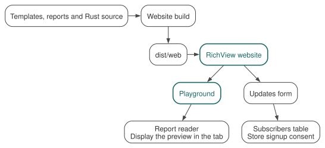

# RichView website and Playground

## Overview

The RichView website serves guides, examples and the Playground at `richview.ai`. The website build (`richview-build`) turns page templates, documentation and example reports into files under `dist/web`. In the browser, the Playground (`richview-site`) accepts edits to Rich Markdown and runs the [Report renderer](core.md) (`richview-core`) to produce an interactive preview. Editing a draft never publishes it to the Cowork report server. An author can download the source, download an HTML report file or copy a link that carries a small draft. [Site build](../../crates/richview-build/src/main.rs#L173) · [Playground controls](../../crates/richview-site/src/browser/authoring.rs#L479)

## Module structure

- [`assets/`](../../assets) contains the pages and public route definitions.
  - [`landing/index.html`](../../assets/landing/index.html) supplies the home page, including the live example.
  - [`landing/anchor/report.rmd`](../../assets/landing/anchor/report.rmd) supplies the source shared by the home page's example and its style previews.
  - [`playground.html`](../../assets/playground.html) defines the editor, checks, download controls and preview frame.
  - [`docs/docs.css`](../../assets/docs/docs.css) styles the public guides and examples.
  - [`routes.json`](../../assets/routes.json) names the top-level files and directories the build keeps and the routes readers can visit.
  - [`_redirects`](../../assets/_redirects) maps alternate addresses to canonical pages.
  - [`_headers`](../../assets/_headers) sets browser security and caching rules for static files.
- [`docs/public/`](../public) holds the guide text and report examples used to build the public documentation.
  - [`gallery/`](../public/gallery) holds Report folders used to generate the gallery's report pages.
  - [`charts/`](../public/charts) holds chart explanations and the list used to select accepted chart pages.
- [`richview-build`](../../crates/richview-build/Cargo.toml) prepares the files served by the website.
  - [`src/main.rs`](../../crates/richview-build/src/main.rs) builds the browser modules, stages the page templates and renders the landing reports.
  - [`src/documentation.rs`](../../crates/richview-build/src/documentation.rs) builds guides, references, gallery pages and their source downloads.
  - [`src/flagship.rs`](../../crates/richview-build/src/flagship.rs#L139) bundles the staged flagship source and its supporting files into a ZIP for readers to download.
  - [`src/chrome.rs`](../../crates/richview-build/src/chrome.rs) provides common page elements such as navigation and the footer.
  - [`src/routes.rs`](../../crates/richview-build/src/routes.rs) removes files outside the public route map.
- [`richview-site`](../../crates/richview-site/Cargo.toml) supplies browser behavior for the website.
  - [`src/bin/docs.rs`](../../crates/richview-site/src/bin/docs.rs) starts the small browser module for documentation pages.
  - [`src/browser.rs`](../../crates/richview-site/src/browser.rs) starts the site controls and exposes rendering to a background worker.
    - [`browser/homepage.rs`](../../crates/richview-site/src/browser/homepage.rs) updates the home page's editable example.
    - [`browser/authoring.rs`](../../crates/richview-site/src/browser/authoring.rs) loads Playground drafts, resolves files, updates the preview and handles exports.
  - [`src/source_buffer.rs`](../../crates/richview-site/src/source_buffer.rs) keeps the full source while showing a manageable portion in the editor.
  - [`src/share.rs`](../../crates/richview-site/src/share.rs) packs source and a style choice into the share link and restores them when the link opens.
- [`wrangler.toml`](../../wrangler.toml) configures the Cloudflare host for the static files and update-signup form.
  - [`cloudflare/interest-worker.mjs`](../../cloudflare/interest-worker.mjs) accepts same-origin requests to subscribe to product updates.
  - [`0001_interest.sql`](../../cloudflare/migrations/0001_interest.sql) defines the subscribers table for that endpoint.

## Architecture

The first part of the diagram happens at build time. A visit to a guide reads an HTML file the build already produced. A visit to the Playground loads browser code as well. There the Report renderer runs inside the tab, and the [Report reader](runtime.md) runs inside the preview frame. The updates form has a separate server-side path to a subscribers table. [Build outputs](../../crates/richview-build/src/main.rs#L233) · [Site host](../../wrangler.toml#L8)

## Pipeline

Follow a published example from its source in the repository to an edited preview in a browser.

1. **Build the browser code.** The build compiles Rust to WebAssembly (Wasm), a binary format browsers can run. It creates distinct modules and JavaScript loading code for the website, the docs controls and the Report reader. [main.rs:193](../../crates/richview-build/src/main.rs#L193) · [main.rs:233](../../crates/richview-build/src/main.rs#L233)

1. **Prepare each page for its route.** The builder combines authored inputs into files the host can serve. [main.rs:318](../../crates/richview-build/src/main.rs#L318)

   - **Home page.** The build inserts the example source, its style and check results into the page template. It renders the landing reports ahead of the visit. The separate Hacker News snippet illustrates a file-backed chart, with month on the horizontal axis and share of mentions on the vertical axis. [Home page snippet](../../assets/landing/index.html#L453) · [main.rs:786](../../crates/richview-build/src/main.rs#L786) · [main.rs:959](../../crates/richview-build/src/main.rs#L959)
   - **Guides and examples.** The documentation builder reads the selected Markdown guides, renders their pages and stages source and report examples. Each chart page’s Copy source block matches the report that opens in the Playground. A file-backed example pairs its source with the CSV it reads. The chart gallery points readers to the elements gallery for flow charts and pivot tables. [Source and data](../../crates/richview-build/src/documentation.rs#L1241) · [Gallery selection](../../crates/richview-build/src/documentation.rs#L222) · [documentation.rs:297](../../crates/richview-build/src/documentation.rs#L297) · [documentation.rs:474](../../crates/richview-build/src/documentation.rs#L474)
   - **Playground.** The build combines the editor template with shared page elements and writes `playground.html`. The template supplies a starting draft for a visit without a source link. [main.rs:804](../../crates/richview-build/src/main.rs#L804) · [playground.html:31](../../assets/playground.html#L31)

1. **Serve the route.** The build prunes the staging directory. The website's static asset binding serves eligible files, applies its redirects and uses the custom 404 page for unknown paths. For example, `/app` redirects to `/playground`. [routes.rs:18](../../crates/richview-build/src/routes.rs#L18) · [wrangler.toml:8](../../wrangler.toml#L8) · [_redirects:5](../../assets/_redirects#L5)

1. **Choose the source.** When the Playground opens, its editor reads the address. [authoring.rs:516](../../crates/richview-site/src/browser/authoring.rs#L516)

   - **Draft link.** A valid `#draft=` fragment supplies the source and selected style. The browser keeps the fragment out of the request to the website.
   - **Example link.** A `?src=` address supplies the source file. A recognized `style` query parameter selects a built-in style.
   - **Plain visit.** The editor starts with the source already in the page.

1. **Resolve the Report folder.** For a source address ending in `.rmd`, the editor fetches the adjacent `report-folder.json`, checks that it names the source and uses its directory as the root. For an inline draft the editor constructs a folder containing only `report.rmd`. [authoring.rs:767](../../crates/richview-site/src/browser/authoring.rs#L767)

1. **Render the current edit.** The editor prepares render options and supplies the Report reader's JavaScript and Wasm bytes. The [Report renderer](core.md) returns HTML and diagnostics. [authoring.rs:722](../../crates/richview-site/src/browser/authoring.rs#L722)

   - **Up to 128 KiB.** The page prepares the document and fetches the files it references from the inventory, then any extra media named by a style. It calls the Report renderer on the page. [authoring.rs:807](../../crates/richview-site/src/browser/authoring.rs#L807)
   - **Over 128 KiB with a worker.** The background worker parses the source and asks the page for missing resources. The page fetches them and sends the bytes back. The worker continues with the saved document and returns the report. [browser.rs:252](../../crates/richview-site/src/browser.rs#L252) · [authoring.rs:954](../../crates/richview-site/src/browser/authoring.rs#L954)
   - **Over 128 KiB without a worker.** The page calls the renderer directly with the available options. This branch skips the small-source resource preparation. [authoring.rs:863](../../crates/richview-site/src/browser/authoring.rs#L863)

1. **Show the result.** The editor checks the edit number before replacing the frame's `srcdoc`, the HTML that the frame displays. It shows the corresponding diagnostics beneath the source. A render failure clears the preview and shows the reasons. [authoring.rs:1053](../../crates/richview-site/src/browser/authoring.rs#L1053) · [authoring.rs:624](../../crates/richview-site/src/browser/authoring.rs#L624)

1. **Keep a copy.** The action determines what leaves the tab. [authoring.rs:479](../../crates/richview-site/src/browser/authoring.rs#L479)

   - **Download .rmd** saves the complete source, including portions outside the visible editing window.
   - **Copy link** puts the compressed source and selected style in the address. Referenced files do not travel in the fragment. [share.rs:24](../../crates/richview-site/src/share.rs#L24)
   - **Download report** renders again with an embedded Report reader and offers an HTML report file. If the source links to local files for download, the editor directs the author to the Command-line program or VS Code so the files can travel with the HTML. [authoring.rs:1094](../../crates/richview-site/src/browser/authoring.rs#L1094)

## What is stored where, and what is rebuilt

| Thing | Where it lives | Who writes it | When it changes or is rebuilt |
| --- | --- | --- | --- |
| Website page templates, styles and example sources | Repository, under `assets/`, `docs/public/` and `examples/` | Page and report authors | An edit becomes a different served file when the website is built and its output delivered. |
| Public HTML | `dist/web/index.html`, `playground.html`, `docs/` and `showcase/` | Website builder | Rebuilt from the templates, guide text, report sources and shared navigation. |
| Report folder inventory | `report-folder.json` beside a staged report source | Website builder | Staging recalculates the files belonging to the source. |
| Website code, docs controls, reader and fonts | Staged JavaScript, Wasm and font files in `dist/web/` | Website builder | A build binds the compiled modules and stages the font catalog as CSS. |
| Reader for linked landing reports | `dist/web/landing/runtime/<id>/` | Website builder | A change to either the JavaScript or Wasm bytes produces a different directory name. |
| Editable draft | Playground tab, in a Rust source buffer | Editor and user | A fresh visit loads a draft link, source URL or the example. Download or copy a draft to keep it. |
| Parsed large draft | Worker memory | Playground worker | Retained across resource requests and taken out of the worker when the render completes. |
| Preview HTML | Preview frame and editor memory | Playground editor | Replaced by the next completed current render or cleared on a render failure. |
| Shared draft | URL fragment on the copied link | Playground editor | The link is a snapshot. Copy a new link to capture later edits. |
| Export | Browser download destination | Author through the browser | Each explicit download takes a copy of the current source or renders the report. |
| Update subscriptions | Cloudflare D1 database, `subscribers` table | Update-signup endpoint | A successful signup records normalized email, consent time and consent version. A duplicate leaves the row in place. |

The browser can request a Report folder inventory and files from a staged example without changing the files on the website. A colleague who needs those files to edit the example should start from its source folder. [Folder inventory writer](../../crates/richview-build/src/main.rs#L526) · [Playground guide](../public/playground.md)

## Configuration and limits

**Website build**

- `RICHVIEW_LANDING=story` includes the home page's scrolling story. The default builds the static presentation. [Landing selection](../../crates/richview-build/src/main.rs#L797)
- `assets/install/release.json` selects whether the install release is enabled and whether its guides include the Windows preview. An enabled install release requires a full native build with `--repository-public`. [Release settings](../../crates/richview-build/src/distribution.rs#L18) · [Build checks](../../crates/richview-build/src/main.rs#L41)
- `--assets-only --local-preview` stages a local website without install routes or install text. `--editor-only` selects the editor packaging path and exits before staging the website. [Build modes](../../crates/richview-build/src/main.rs#L105)
- `--feedback-enabled` selects the feedback form for a configured collector. Without it, a reader can keep a local feedback note. [Feedback controls](../../crates/richview-build/src/documentation.rs#L741) `--repository-public` allows links to the source repository in the staged site. [Documentation flags](../../crates/richview-build/src/main.rs#L326)
- `CARGO_TARGET_DIR` locates compiled output. `CARGO` selects Cargo and `WASM_BINDGEN` selects the tool that generates JavaScript bindings for Wasm. [Cargo selection](../../crates/richview-build/src/main.rs#L104) · [Target directory](../../crates/richview-build/src/main.rs#L113) · [Binding tool](../../crates/richview-build/src/main.rs#L469)

The build writes the entry script that decides which module a page starts.

| Page | Entry point | What runs |
| --- | --- | --- |
| Documentation or install | [Docs entry](../../crates/richview-site/src/bin/docs.rs) | Lightweight page controls, including Copy buttons. |
| Playground | [Site entry](../../crates/richview-site/src/browser.rs#L356) | The editor and render scheduling in the parent page. |
| Large draft | [Worker loader](../../crates/richview-build/src/main.rs#L315) | A separate instance of the site module, with the font catalog provided to its renderer. |
| Report preview | [Preview resources](../../crates/richview-site/src/browser.rs#L75) | The Report reader runs with the rendered document. |

**3 raw Wasm modules.** With `--wasm-from DIR` the builder requires exactly `docs.wasm`, `richview_site.wasm` and `richview_runtime.wasm` as regular Wasm files. A missing or extra file prevents staging. [Input checks](../../crates/richview-build/src/manifest.rs#L38)

**3 initial report runtimes per docs page.** The documentation build counts the page's own reader script and frames that initially point to internal pages. A docs page over this budget fails the build. [Runtime budget](../../crates/richview-build/src/documentation.rs#L698)

**16 hexadecimal characters in a landing reader address.** The builder uses the prefix of a SHA-256 fingerprint of the JavaScript and Wasm. The host can cache these named assets for **31,536,000 seconds** because changed bytes get a new address. [Address calculation](../../crates/richview-build/src/main.rs#L995) · [Cache headers](../../assets/_headers)

**140 milliseconds after typing in the home example.** The home page groups quick edits into one render. The chart-type picker waits for **400 milliseconds** of rest and works in slices of **12 milliseconds** so the page can draw between them. [Home edit delay](../../crates/richview-site/src/browser/homepage.rs#L41) · [Chart picker](../../crates/richview-site/src/browser/toolbar.rs#L15)

**Playground**

**128 KiB or 512 lines.** Crossing either threshold switches the source editor to pages. In paged mode, a visible window is limited to **64 KiB** and **512 lines**. Copy and download still use the entire source. Worker selection depends on bytes alone. [Source buffer](../../crates/richview-site/src/source_buffer.rs#L7) · [Worker selection](../../crates/richview-site/src/browser/authoring.rs#L859)

**32 milliseconds after an edit.** The Playground schedules a render and compares its edit number with the latest edit when the timer fires. A busy worker keeps **1 active job and 1 pending edit**. A later edit replaces the pending one. [Edit timer](../../crates/richview-site/src/browser/authoring.rs#L708) · [Worker queue](../../crates/richview-site/src/browser/authoring.rs#L909)

**16 MiB of report source, 16 MiB per dataset, 64 MiB of rendered output.** The Playground uses the Report renderer's parser on both paths. Source over the parser's limit produces a diagnostic. The same renderer enforces dataset and output budgets. [Renderer limits](../../crates/richview-core/src/document.rs#L52)

**8,000 bytes for the complete share link.** The limit includes the page address and encoded fragment. If the draft will not fit, the Playground offers the source download. Opening a draft link limits decompressed JSON to **4 MiB**. A fragment that fails to decode falls through to the example URL or the page's starting draft. [Share link encoder and decoder](../../crates/richview-site/src/share.rs#L24)

**Preview isolation.** The frame permits scripts so the Report reader can run. The parent supplies reader assets and checks that a referenced resource resolves under the Report folder's own origin and path. [Preview frame](../../assets/playground.html#L60) · [Resource checks](../../crates/richview-site/src/browser/authoring.rs#L1015)

The editor treats missing inputs differently depending on what the Report folder promises.

- If the folder inventory for a linked source fails to load or names a different source, the editor reports the folder error and stops. [Manifest checks](../../crates/richview-site/src/browser/authoring.rs#L772)
- If the draft refers to a file outside the inventory, the renderer can show a finding on the affected element. [Draft preparation](../../crates/richview-site/src/lib.rs) · [Worker parsing](../../crates/richview-site/src/browser.rs#L260)
- If a file in the inventory cannot be fetched during resource resolution, the editor clears the failed preview and names the file. [Resource resolution](../../crates/richview-site/src/browser/authoring.rs#L954)
- If the report requests the math font, the parent fetches and checks the bundled font stylesheet and puts it directly into the preview HTML. A failed load can be retried on the next render. [Font resolution](../../crates/richview-site/src/browser.rs#L191)

**Website host**

- The static asset binding `ASSETS` points at `./dist/web`. The host sends `/api/*` to the Cloudflare Worker first. The only application endpoint there is `POST /api/interest`, for product-update consent. Report publication uses the [Cowork report server](server.md). [Host configuration](../../wrangler.toml#L8) · [Endpoint dispatch](../../cloudflare/interest-worker.mjs#L31)
- `INTEREST_DB` selects the subscription database. `SIGNUP_RATE_LIMIT` selects the request limiter. Signup returns HTTP 503 if either binding is missing. The endpoint sends no mail. [Subscription handler](../../cloudflare/interest-worker.mjs#L42)

**1,024 bytes per signup request, 254 characters per email.** The endpoint accepts JSON from its own origin, requires explicit consent, normalizes the address and checks its format. Invalid input returns HTTP 400. [Body and field checks](../../cloudflare/interest-worker.mjs#L9)

The table's unique email field makes submitting the form again safe. Both a new address and an existing address get the same success response after the database acknowledges the write. [Database insert](../../cloudflare/interest-worker.mjs#L55)

**10 signup attempts per 60 seconds per address.** The Worker uses the connecting IP address for the rate check. An excess attempt returns HTTP 429 and asks the visitor to wait **60 seconds**. The IP address is absent from the subscribers table. [Rate configuration](../../wrangler.toml#L21) · [Table definition](../../cloudflare/migrations/0001_interest.sql)
