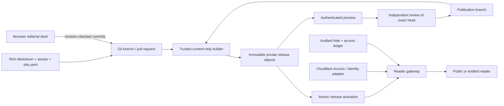

# RichView Publish

RichView Publish turns a Git content tree into an edited publication: a front page, sections, searchable archives, reports and static pages. The maintained example is **RichView News**, configured in [`publications/news/site.yaml`](../../publications/news/site.yaml).

Rich Markdown remains the authored format. Charts supplies the shared rendering capability. Reports are the publishable experience; Publish supplies their publication, editorial, access and release layer. The existing Server retains its native hosting and report-storage API. The VS Code extension remains an authoring surface. This change neither removes Server nor changes existing clients' routes.

Server still owns its native report publication API and immutable slug/version store. Publish owns publication-level composition, reader policy, the editorial bridge and the active release pointer. It reuses the current resolver, renderer and browser runtime while adding a dedicated gateway for coherent access and urgent withdrawal. Existing Server reports are not migrated automatically. A later adapter can consume versioned Server artifacts behind the same publication gateway; moving that storage boundary must preserve the existing clients and keep every protected delivery route under the access layer.

The native builder uses the existing Rust resolver, renderer and WebAssembly interaction runtime. The Cloudflare adapter uses a private R2 bucket and a SQLite Durable Object. Every delivery route passes through that gateway. R2 is not a public website, and Worker preview and `workers.dev` URLs are disabled in the deployment template.

Read [setup and operations](operations.md), [the content contract](content.md), [access and editorial control](access.md), and [verification](verification.md). The public-safe product brief is retained in [`tasks/richview-publish.md`](../../tasks/richview-publish.md).

## What ships in this version

- Broadsheet and Dispatch layouts, Paper and Ink themes, explicit lead ordering and configurable navigation in one site YAML file.
- Stable item identities, former-slug aliases, dated corrections, section/tag metadata, explicit states and audiences.
- Real RichView report charts and local resources.
- Public-only RSS, sitemap and search JSON; authenticated member reading; protected editorial previews.
- Source editing, new drafts, site configuration edits, independent review, source-to-live status, scoped role administration and immediate withdrawal.
- Immutable releases, stale-job rejection, a persistent withdrawal ledger and repeatable rollback.

## Deliberate boundaries

The browser editor is a small source editor. Its full Rich Markdown header is editable, including title, summary, section, audience and correction notes. It is not a WYSIWYG editor. It creates ordinary Git pull requests; it has no independent content database.

Publish publishes reports and static pages only (FEA-BR-30). `publish.kind: dashboard` and `publish.snapshot` fail validation; dashboard snapshot pages return only together with a dashboard product and its own lockdown. The live trading-desk page stays on the News site running PR #70.

The release builder is intentionally a bounded full build: at most 1,000 item folders, 20 MiB per object and 256 MiB per release. These are enforced safety bounds, not performance or concurrency claims. The fixture generator measures a representative 300-item build without committing its generated output.

Curated periodic editions, newsletters, e-paper/print composition, full visual editing, payments, advertisements, comments, CRM, enterprise multi-tenancy and a CMS extension marketplace are deferred. Stable item IDs and the separation between authored content, report artifacts and publication templates leave those options open.
